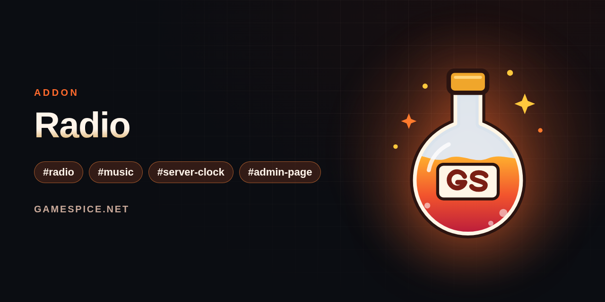

[](https://github.com/gamespice-platform/dot-radio)

An in-game radio for a game server. The operator uploads MP3 and OGG tracks through a small admin page (or the JSON API). The server plays them as one station, and every player who tunes in hears the same track at the same point. Design notes: [docs/design.md](docs/design.md).

**Licensing: this addon only provides upload functionality. It ships no audio and does not supply, license or check the rights to any music. Operators supply their own audio and are responsible for having the right to broadcast it.**

## Install

1. Get [Godot 4.7](https://godotengine.org/download).
2. Either use [dot-bootstrap](https://github.com/gamespice-platform/bootstrap), which clones every project and links the addons, or copy `addons/dot_radio/` and [dot-core](https://github.com/gamespice-platform/core)'s `addons/dot_core/` into your project and enable dot-radio in *Project > Project Settings > Plugins*.

## Server

```gdscript
var radio := DotRadioHttp.new()
radio.start_from_config(DotRadioHttp.read_config())   # the radio: block of cfg/server.yml
# in _process:
radio.poll()
```

```yaml
radio:
  enabled: true
  bind: 127.0.0.1
  port: 8791
  token_file: /etc/dot/radio.token
  max_track_mb: 20
  upload_timeout_sec: 120
```

| Key | Default | Meaning |
| --- | --- | --- |
| `enabled` | off | The radio does nothing unless set to true. |
| `bind` | `127.0.0.1` | Loopback only. Change it when a proxy or TLS is in front. |
| `port` | 8791 | HTTP port. |
| `token_file` | none | File holding the admin token. The token is never read from the yml, environment or command line. |
| `max_track_mb` | 20 | Largest upload in megabytes. |
| `upload_timeout_sec` | 120 | Seconds to wait for an upload. |

Open `http://127.0.0.1:8791/`, paste the token and drop files. Admin routes need `Authorization: Bearer <token>`.

| Routes | Who |
| --- | --- |
| `GET /now`, `GET /tracks`, `GET /track/<id>` | Anyone |
| `POST /api` with `{"op": ...}`, `GET\|POST /api/<op>`, `PUT /api/tracks/<file name>?title=&artist=` (raw body), `DELETE /api/tracks/<id>` | Admin |

```bash
curl -T song.mp3 -H "Authorization: Bearer $(cat radio.token)" "http://127.0.0.1:8791/api/tracks/song.mp3?title=Song"
```

| Ops | Who |
| --- | --- |
| `now`, `tracks`, `playlist`, `request`, `rate` | Listeners |
| `upload`, `delete`, `edit`, `reorder`, `playlist_add`, `playlist_remove`, `queue`, `dequeue`, `clear_queue`, `skip`, `mode`, `start`, `stop` | Admin |

To share another `DotHttpServer` instead of opening a second port, call `radio.mount(server, "/radio")`.

## Client

```gdscript
var radio := DotRadioClient.new()
radio.base_url = "http://server:8791"
radio.sink = DotRadioSinkGodot.new()   # then radio.sink.attach(self)
add_child(radio)
```

Playback starts only when the player presses the toggle key.

| Action | Default key |
| --- | --- |
| `radio_toggle` | F8 |
| `radio_mute` | F9 |
| `radio_volume_up` / `radio_volume_down` | Page Up / Page Down |

The actions are added to the InputMap only if your project has not defined them, so players can rebind them. `DotRadioCommands` adds `!radio`, `!song`, `!request <title>` and `!rate up|down` to any command registry with `add_command(name, help, fn)`.

Web builds work: files are fetched with `HTTPRequest`, and the public routes allow any origin.

## Testing

Link dot-core into `addons/`, import the project once, then run `examples/radio_selftest.tscn` headless with Godot. The two files in `examples/fixtures/` are sine tones generated for the tests.

## Status and licence

Part of the [**GameSpice**](https://gamespice.net) platform of Godot addons. Written with Claude Code and maintained by `gamemann`. Every addon has headless tests, but little of this has been played by real users yet, so expect rough edges and please [open an issue](https://github.com/zees-games/dot-radio/issues) when you hit one.

MIT licence, see [LICENSE](LICENSE). The only closed part of the [**GameSpice**](https://gamespice.net) platform is the web back end; you can use your own instead of GameSpice's.
